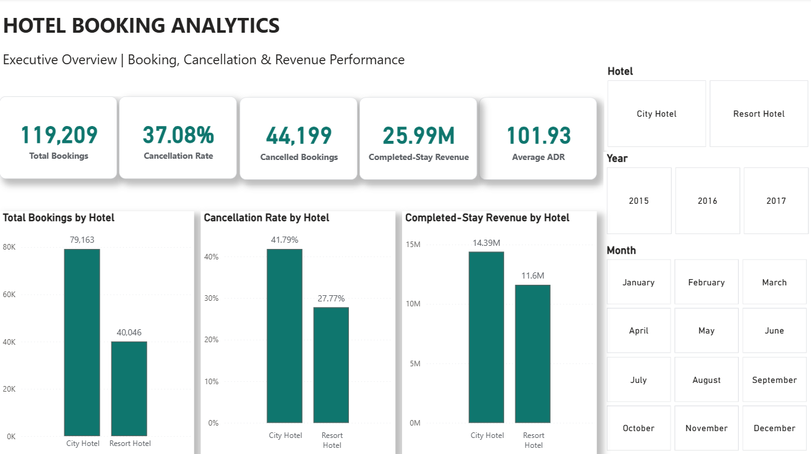
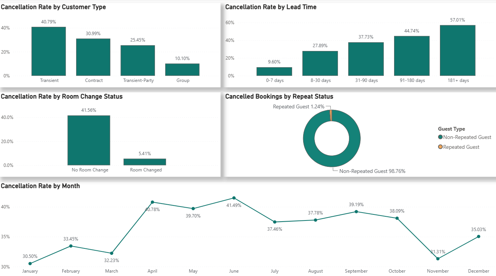
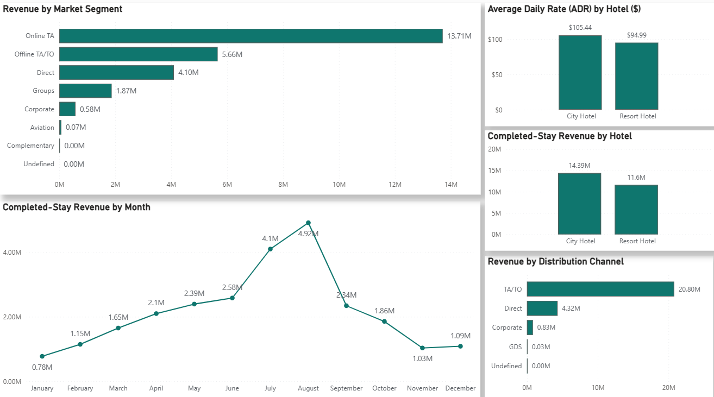

# Hotel Booking Analytics

**End-to-End Data Analytics Project | Python • SQL • Power BI**

This project analyses hotel booking data to understand booking patterns, cancellation behaviour, customer segments, and revenue performance across City Hotel and Resort Hotel.

The analysis covers 119,209 bookings and follows a complete workflow, starting with data cleaning and exploratory analysis in Python, followed by SQL analysis and interactive Power BI dashboards. The aim is to identify useful patterns that can support hotel booking management, cancellation monitoring, and revenue planning.

## Project Objectives

The main objectives of this project are to:

- Analyse booking patterns across City Hotel and Resort Hotel.
- Examine cancellation rates and identify booking factors associated with cancellations.
- Understand how lead time, customer type, and repeat-guest status relate to cancellation behaviour.
- Compare hotel performance using booking volumes, average daily rates (ADR), and estimated completed-stay revenue.
- Explore monthly booking and revenue trends to identify seasonal patterns.
- Present the findings through interactive Power BI dashboards to support business decisions.

## Tools & Technologies

- **Python (Google Colab):** Data cleaning, data preparation, exploratory data analysis (EDA), and feature creation using Pandas, NumPy, Matplotlib, and Seaborn.
- **SQL (SQLite):** Data validation, booking and cancellation analysis, customer behaviour analysis, revenue analysis, and advanced queries using CTEs and window functions.
- **Power BI:** Interactive dashboards for booking performance, cancellation patterns, customer behaviour, and revenue trends.
- **GitHub:** Project documentation, version control, and portfolio presentation.

## Project Workflow

The project was completed in the following stages:

1. **Data Collection:** Obtained the Hotel Booking Demand dataset from Kaggle.
2. **Data Cleaning (Python):** Inspected the dataset, handled data quality issues, and prepared the data for analysis.
3. **Exploratory Data Analysis (Python):** Analysed booking trends, cancellations, customer behaviour, pricing, and revenue.
4. **SQL Analysis:** Used SQL queries to validate the cleaned data and examine booking performance, cancellation patterns, customer segments, and revenue.
5. **Power BI Dashboard:** Created three interactive dashboard pages to present the main findings.
6. **Project Report:** Documented the analysis, key findings, business recommendations, and limitations.

## Dataset Overview

The project uses the Hotel Booking Demand dataset, which contains booking records for two hotel types: City Hotel and Resort Hotel.

The original dataset contains approximately 119,390 booking records, covering arrivals between 2015 and 2017.

During data preparation in Python:
- Removed 180 bookings with zero guests.
- Removed one booking with a negative Average Daily Rate (ADR).
- Retained duplicate-looking records because they could represent separate bookings.
- Created additional columns for total nights, total guests, estimated revenue, booking lead-time categories, and other analytical measures.

After cleaning, the final dataset contains **119,209 bookings and 42 columns**.

Both the original and cleaned datasets are available in the `Data` folder.

**Dataset Source:** [Hotel Booking Demand – Kaggle](https://www.kaggle.com/code/arunkumarpyramid/eda-with-hotel-booking-demand-ml-dl/notebook)

## Key Findings

The Python, SQL, and Power BI analysis highlighted several important patterns:

- **Overall Cancellation Rate:** Out of 119,209 bookings, 44,199 were cancelled, resulting in an overall cancellation rate of 37.08%.
- **Hotel Comparison:** City Hotel had a higher cancellation rate (41.79%) than Resort Hotel (27.77%).
- **Booking Lead Time:** Bookings made 181 or more days in advance had a cancellation rate of 57.01%, compared with 9.60% for bookings made within 0–7 days.
- **Repeat Guests:** Repeated guests had a much lower cancellation rate (14.65%) than first-time guests (37.81%).
- **Customer Type:** Transient customers had the highest cancellation rate (40.79%), while Group customers had the lowest (10.10%).
- **Revenue Performance:** City Hotel generated approximately 14.39M in estimated completed-stay revenue, compared with 11.60M for Resort Hotel.
- **Distribution Channels:** The TA/TO channel contributed the largest share of estimated completed-stay revenue, approximately 20.80M.
- **Seasonal Trends:** Estimated completed-stay revenue was highest in August (4.92M), followed by July (4.10M).

These findings suggest that booking lead time, customer type, and repeat-guest status are useful factors for monitoring cancellation risk. Revenue analysis also highlights the importance of distribution channels and seasonal demand.

## Power BI Dashboard

The Power BI dashboard contains three interactive pages covering hotel booking performance, cancellation behaviour, and revenue trends.

### Page 1: Executive Overview

This page provides an overview of total bookings, cancellation rates, estimated completed-stay revenue, average daily rate (ADR), and hotel performance.

### Page 2: Booking & Cancellation Analysis

This page examines cancellation patterns across customer types, booking lead times, room change status, repeat-guest status, and arrival months.

### Page 3: Revenue & Seasonal Trends

This page compares estimated completed-stay revenue across hotels, market segments, distribution channels, and months, along with average daily rates.

## Project Files & Repository Structure

The repository is organised into the following folders:

| Folder | Contents |
|---|---|
| `Python/` | Google Colab notebook containing data cleaning, preparation, and exploratory data analysis. |
| `SQL/` | SQL queries covering data validation, cancellations, customer behaviour, and revenue analysis. |
| `PowerBI/` | Interactive Power BI dashboard (`.pbix`) with three analytical pages. |
| `Data/` | Original hotel booking dataset and cleaned dataset used for analysis. |
| `Report/` | Complete project report in PDF format, including findings, recommendations, and limitations. |
| `Screenshots/` | Screenshots of the three Power BI dashboard pages. |

The Python notebook, SQL queries, Power BI file, and project report are available in their respective folders for further review.

## Business Recommendations

Based on the analysis, the following recommendations could help hotels improve booking and revenue management:

- **Manage Long-Lead-Time Bookings:** Consider booking reminders and reconfirmation strategies for reservations made far in advance, as these have higher cancellation rates.
- **Encourage Repeat Bookings:** Strengthen guest retention through loyalty initiatives and personalised offers, as repeated guests show lower cancellation rates.
- **Monitor High-Cancellation Customer Segments:** Pay closer attention to Transient customers and other booking segments associated with higher cancellation rates.
- **Review City Hotel's Cancellation Strategy:** Investigate booking policies, customer characteristics, and distribution channels contributing to City Hotel's higher cancellation rate.
- **Monitor Distribution Channels:** Review the high concentration of estimated completed-stay revenue from TA/TO and explore opportunities to strengthen direct bookings.
- **Use Seasonal Trends for Planning:** Consider historical revenue and ADR patterns when planning pricing, promotions, staffing, and capacity.

These recommendations are based on patterns observed in the historical dataset. They are suggested areas for further investigation rather than proven solutions.

## Project Limitations

- **Historical Data:** The dataset covers arrivals from July 2015 to August 2017, so the findings may not reflect current hotel booking behaviour.
- **Limited Hotel Coverage:** The analysis includes only one City Hotel and one Resort Hotel, so the results may not represent the wider hotel industry.
- **Estimated Revenue:** Revenue was calculated using ADR × total nights for completed stays. These figures are estimates rather than verified financial revenue.
- **Partial-Year Coverage:** The dataset does not contain complete calendar years for 2015 and 2017, which should be considered when interpreting monthly trends.
- **Association vs. Causation:** Differences in cancellation rates across customer groups, booking lead times, and room-change status do not establish causal relationships.

## Dataset Source & References

The dataset was originally published by António, N., de Almeida, A., and Nunes, L. (2019) in *Hotel booking demand datasets*.

- **Original Publication:** [Hotel booking demand datasets](https://doi.org/10.1016/j.dib.2018.11.126)
- **Kaggle Source:** [EDA with Hotel Booking Demand ML & DL](https://www.kaggle.com/code/arunkumarpyramid/eda-with-hotel-booking-demand-ml-dl/notebook)

The original and cleaned CSV files are included in the `Data` folder for reference and reproducibility.

## Explore the Project

You can explore the complete analysis through the following project files:

- **[Python Analysis](Python/Hotel_Booking_Analytics.ipynb)** — Data cleaning, feature engineering, and exploratory data analysis.
- **[SQL Analysis](SQL/Hotel_Booking_SQL_Analysis.sql)** — SQL queries for booking patterns, cancellations, customer behaviour, and revenue.
- **[Power BI Dashboard](PowerBI/Hotel_Booking_Analytics_Dashboard.pbix)** — Interactive three-page dashboard.
- **[Project Report](Report/Hotel_Booking_Analytics_Report.pdf)** — Detailed analysis, findings, business recommendations, and limitations.
- **[Cleaned Dataset](Data/hotel_bookings_cleaned.csv)** — Final dataset used for SQL and Power BI analysis.

The project demonstrates an end-to-end data analytics workflow, from preparing raw data to generating business insights and presenting them through interactive dashboards.
